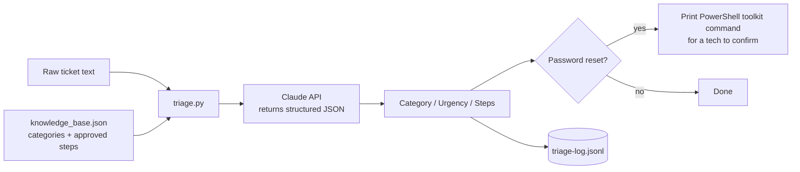

# AI-Assisted Help Desk Ticket Triage


A Python command-line tool that reads a raw help desk ticket and returns a **category**, an **urgency level with reasoning**, and **first-response troubleshooting steps** pulled from a knowledge base I wrote, so a Tier 1 technician can triage faster and more consistently.

Built as a follow-up to my [PowerShell Help Desk Automation Toolkit](https://github.com/alex19992020/PowerShell-IT-automation-toolkit): when a ticket looks like a password reset, this tool points the technician to the exact toolkit command to run.


---

## At a glance

| | |
|---|---|
| **Problem** | Tier 1 techs spend time on the same first questions for every ticket: *what kind of issue is this, how urgent is it, what do I try first?* |
| **Solution** | An LLM classifies the ticket against a fixed set of categories and suggests steps from an approved knowledge base, not from whatever the model happens to know. |
| **Key design choice** | **Human in the loop.** The tool never touches Active Directory, never resets a password, and never changes an account. It only suggests. |
| **Result** | Correctly classified tickets across Account/Password, Network/VPN, and Hardware, and returned **Uncategorized** for a vague ticket instead of guessing. |

## Skills demonstrated

| Help desk skill | Where it shows up in this project |
|---|---|
| Ticket triage and prioritization | Category + Low/Medium/High urgency, with a one-sentence reason a supervisor can audit |
| Documented, repeatable procedures | `knowledge_base.json` holds standard first-response steps for each category |
| Security awareness / least privilege | No autonomous account changes; every action needs a person to confirm and run it |
| Troubleshooting and debugging | Diagnosed and fixed a response-parsing crash (see [Debugging](#debugging-a-real-issue)) |
| Scripting and automation | Python CLI, API integration, environment-variable secrets, JSON logging |
| Tool integration | Password-reset tickets link straight to the PowerShell AD toolkit command |
| Audit trail | Every triage result is logged with a timestamp to `triage-log.jsonl` |

---

## Why the tool doesn't take action on its own

This was a deliberate decision, not a missing feature. A help desk tool that resets passwords or unlocks accounts on its own, based on free-text input, is a security risk: anyone who can write a convincing ticket could trigger an account change.

So the tool is scoped to the part of triage that is genuinely repetitive (*"what's probably going on, and what should I try first?"*) and leaves every account change to a person. Even when it detects a password reset, it only **prints** the command for the technician to verify and run.

## How it works



1. **Knowledge base.** `knowledge_base.json` defines five categories (Account/Password, Network/VPN, Hardware, Software/Access, Email) and the standard first-response steps for each.
2. **Grounded prompt.** `triage.py` sends the ticket plus the knowledge base to Claude and instructs it to base its steps on that knowledge base, to use **Uncategorized** when nothing fits, and to reply with JSON only.
3. **Structured output.** The response is parsed into fixed fields (`category`, `urgency`, `urgency_reason`, `suggested_steps`, `is_password_reset_flow`), so output is consistent from ticket to ticket.
4. **Urgency rules.** High = user fully blocked or multiple users affected (possible outage). Medium = impacted but has a workaround. Low = minor, not blocking work.
5. **Logging.** Each result is appended to `triage-log.jsonl` with the timestamp and original ticket text.

---

## Testing and results

I tested the tool with realistic tickets, including one written as vaguely as real users often write them.

| Ticket text | Category returned | What it shows |
|---|---|---|
| "user can't log into their email, password not working" | Account/Password | Full pipeline works; password-reset flag triggered the PowerShell toolkit tie-in |
| "user says they can't connect to the VPN from home" | Network/VPN | Correct category; steps pulled from the knowledge base |
| "printer on the 3rd floor isn't printing" | Hardware | Rated **Medium, not High**: affects several people, but nearby printers are a workaround. Real impact reasoning, not keyword matching. |
| "my computer is being weird" | **Uncategorized**, Low | Didn't force a guess. Returned steps to **gather more information** instead of generic fixes. |

**The vague ticket was the most important test.** Real tickets are often this unclear, and a tool that confidently picks the wrong category sends the technician down the wrong path. I'd rather the tool admit it doesn't have enough information than fake confidence.

**First end-to-end test** (password ticket, with the toolkit tie-in triggered):


### Debugging a real issue

| | |
|---|---|
| **Symptom** | The script occasionally crashed while reading the model's response. |
| **Root cause** | The code assumed the answer was always the first block of the response. Some responses include a non-text block (such as a reasoning block) before the actual text. |
| **Fix** | Loop through the response and use the first **text** block. I also added handling for JSON wrapped in markdown code fences, and clear error messages for API errors and unparseable output. |
| **Verification** | Re-ran the test tickets successfully, then committed and pushed the fix. |


---

## Example output

```
Enter the ticket description: user forgot their password and is locked out

==================================================
Category:  Account/Password
Urgency:   Medium - user is blocked from work but this is a routine, well-understood fix

Suggested first-response steps (review before acting):
  1. Confirm the exact error message the user sees at login.
  2. Check if the account is locked out (repeated bad password attempts).
  3. Reset the password and force a change at next logon.
  4. Unlock the account if locked.

[Password reset flow detected]
If confirmed, the command to run against the AD lab toolkit is:
  .\Reset-HelpDeskPassword.ps1 -Username "<username>" -Unlock
Replace <username> with the actual account - this is NOT run automatically.
==================================================
```

## Setup

**Requirements:** Python 3 and an Anthropic API key from [console.anthropic.com](https://console.anthropic.com) (separate from a claude.ai login).

```powershell
# 1. Clone and install the dependency
git clone https://github.com/alex19992020/AI-IT-Ticket-Triage.git
cd AI-IT-Ticket-Triage
pip install -r requirements.txt

# 2. Set your API key for this session (never commit it to the repo)
$env:ANTHROPIC_API_KEY = "your-key-here"        # Windows PowerShell
# export ANTHROPIC_API_KEY="your-key-here"      # macOS/Linux
```

<details>
<summary>Screenshot: installing dependencies</summary>


</details>

## Usage

```powershell
# Interactive: type the ticket when prompted
python triage.py

# Or pass the ticket directly
python triage.py --ticket "user says they can't connect to the VPN from home"
```

## Project structure

```
AI-IT-Ticket-Triage/
├── triage.py              # CLI: builds the prompt, calls the API, parses, prints, logs
├── knowledge_base.json    # Categories and approved first-response steps (editable)
├── requirements.txt       # anthropic SDK
└── triage-log.jsonl       # Created at runtime: timestamped history of every triage
```

## Limitations and next steps

- **Input quality matters.** Vague tickets get cautious results. That's by design, but it means the tool works best when users give detail.
- **Small knowledge base.** Five categories is enough to prove the approach. A production version would be built from a real IT team's ticket history.
- **Each ticket is independent.** No memory between runs beyond the log file.
- **Next:** an intake assistant that asks the user for the missing details (device, error message, when it started) *at submission*, so vague tickets like "my computer is being weird" arrive ready to triage.

## Related projects

- [PowerShell Help Desk Automation Toolkit](https://github.com/alex19992020/PowerShell-IT-automation-toolkit): new-hire provisioning, password reset/unlock with logging, and user health checks against my Active Directory home lab.

---

**Angel "Alex" Antunez** · B.S. Computer Science, San Francisco State University · Seeking help desk / IT support roles · [LinkedIn](https://linkedin.com/in/alejandro007)
